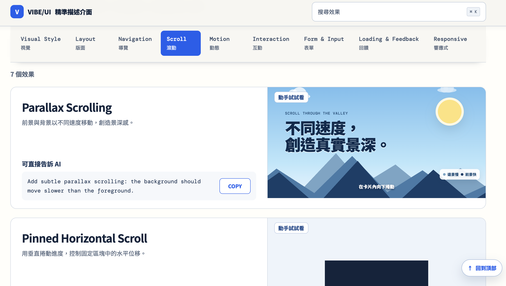

# Vibe UI Patterns

Vibe UI Patterns（VIBE/UI）是一個互動式 UI／UX 詞彙參考網站，協助使用者理解常見的介面模式、動畫與互動效果，並將想法轉換成可以直接交給 AI Coding Agent 的精準提示詞。

本專案為 NTU 課程所製作，提供學習 Vibe Coding 的學員作為課程教材與實作參考。

網站以繁體中文解釋概念，保留英文技術名稱與 AI Prompt，適合剛開始接觸 Vibe Coding 的使用者，以及希望更準確描述前端需求的開發者。

## Live Demo

[立即體驗 Vibe UI Patterns](https://vibe-coder-ui-library.madihsiang.workers.dev/)

## 專案畫面




## 功能特色

- 收錄 65 個 UI／UX Pattern。
- 涵蓋 Scroll、Layout、Motion、Interaction、Navigation、Loading & Feedback、Form & Input、Responsive 與 Visual Style 等分類。
- 每個 Pattern 都包含中文說明、英文提示詞與互動展示。
- 可透過分類 Tab 快速瀏覽，切換後會自動定位到效果數量列。
- 支援關鍵字搜尋與 `Command/Ctrl + K` 快捷鍵。
- 提供一鍵複製 AI Prompt。
- Demo 支援點擊、拖曳、捲動、Hover 等實際操作。
- 支援桌面與行動裝置版面。
- 尊重 `prefers-reduced-motion`，減少非必要動畫。

## 技術架構

- React
- Vite
- JavaScript
- CSS

這是一個純前端靜態網站，不需要後端服務或資料庫。

## 快速開始

請先安裝 Node.js 的近期 LTS 版本與 npm。

```bash
npm install
npm run dev
```

啟動後，依照終端機顯示的本機網址開啟網站。

## 可用指令

| 指令 | 用途 |
| --- | --- |
| `npm run dev` | 啟動 Vite 開發伺服器 |
| `npm run build` | 建立正式版靜態檔案 |
| `npm run preview` | 在本機預覽正式版建置結果 |
| `npm run check` | 清空輸出目錄並執行完整建置檢查 |

正式版檔案會輸出至 `build/` 目錄。

## 使用方式

1. 從分類列選擇想了解的 UI／UX 類型。
2. 閱讀 Pattern 名稱與中文說明。
3. 在右側或下方的 Demo 區域實際操作效果。
4. 點擊 `COPY` 複製英文 Prompt。
5. 將 Prompt 貼給 AI Coding Agent，再依產品需求補充內容、品牌與技術限制。

也可以按下 `Command + K` 或 `Ctrl + K`，直接搜尋特定效果。

## 專案結構

```text
.
├── src/
│   ├── App.jsx          # 主要頁面、元件與互動邏輯
│   ├── main.jsx         # React 進入點
│   ├── patterns.js      # Pattern 資料、分類與 Demo HTML
│   ├── styles.css       # 基礎樣式與 Demo 樣式
│   └── redesign.css     # 現行視覺設計與響應式調整
├── PRODUCT.md           # 產品定位、使用者與原則
├── DESIGN.md            # 視覺系統與介面設計規範
├── vibe-coding-ui-pattern-vocabulary.md
│                        # 詞彙、定義與 Prompt 參考資料
├── vite.config.js       # Vite 與建置設定
└── package.json         # 相依套件與 npm 指令
```

## 新增或修改 Pattern

Pattern 的主要資料位於 `src/patterns.js`。

每筆資料包含：

```js
[
  'Pattern 名稱',
  '分類標籤',
  '繁體中文說明',
  '英文 AI Prompt',
  'Demo key',
]
```

新增 Pattern 時，請同步完成以下項目：

1. 將資料加入正確的分類。
2. 在 `demoHTML()` 中加入對應的 Demo 結構。
3. 在樣式檔中補上必要的視覺與互動狀態。
4. 確認鍵盤操作、手機版面與 Reduced Motion 表現。
5. 執行 `npm run check` 確認可以正常建置。

## 設計原則

- 用核心行為解釋 Pattern，而不是堆疊裝飾。
- Demo 只聚焦一個主要差異，避免不必要的複雜度。
- 優先使用準確、簡潔且可以直接運用的文字。
- 清楚區分標準、UX Pattern 與常見社群術語。
- 保持足夠的文字對比、可見焦點與觸控操作範圍。

更完整的產品與設計背景請參考 `PRODUCT.md` 與 `DESIGN.md`。

## 建置與部署

```bash
npm run build
```

建置完成後，可將 `build/` 目錄部署至支援靜態網站的託管服務。Vite 的 `base` 設定為 `/`，預期網站部署在網域根目錄。
